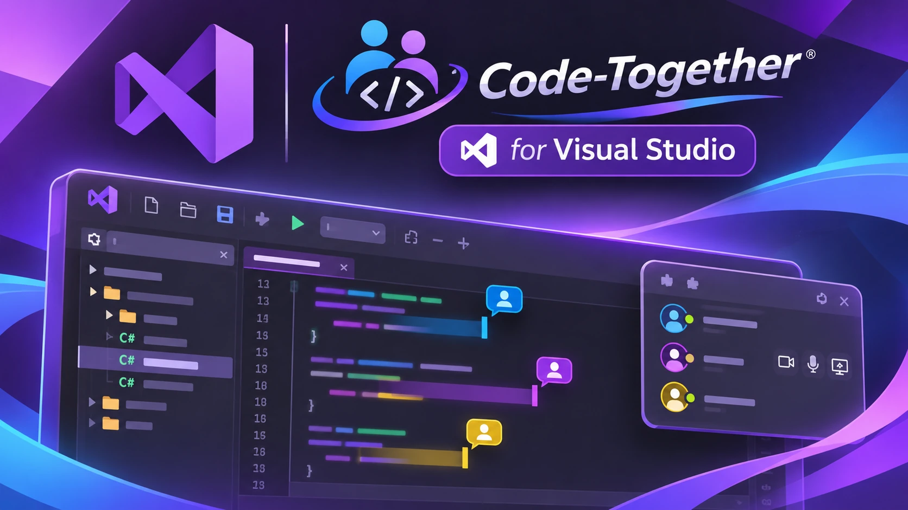

# Code Together for Visual Studio

The planned Visual Studio extension will bring Code Together sessions into the IDE through Shared Perspective. The design includes shared chat and presence, teammate activity, and live code collaboration.

This repository is the home for the Visual Studio adapter. Installation and build instructions will be added when an extension build is available.

[Code Together overview](https://github.com/KD-Kevin/code-together) · [Shared Perspective](https://github.com/KD-Kevin/Shared-Perspective)
